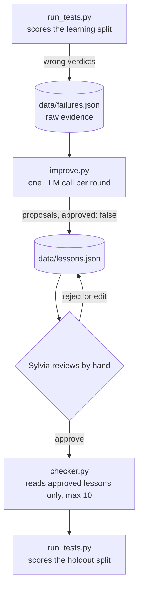

# Design: `improve.py`, the lesson generator

Owner: Sylvia (C). Status: implemented in `improve.py` and `tests/test_improve.py`; updated 2026-10-13
to match the code. The offline tests pass. The first run against a real model is still pending,
because no API key or model ID is configured yet.
Related files: `contracts/schema.py` (`Failure`, `Lesson`), `checker.py` (lesson selection),
`run_tests.py` and `run_rounds.py` (Amitej), README "Evaluation and improvement protocol".

## 1. What this script does

`improve.py` turns the learning-split mistakes in `data/failures.json` into short, general
lessons in `data/lessons.json`. A human then approves the good ones. `checker.py` reads only
approved lessons (at most ten per model) and adds them to its prompt. Nothing here changes
model weights; the loop changes the instructions the checker sees.



### Failure versus lesson

| | Failure | Lesson |
|---|---|---|
| Meaning | One specific wrong verdict, with the gold answer | One general rule drawn from one or more failures |
| Made by | `run_tests.py`, mechanically | `improve.py` proposes, a human approves |
| Contains gold label | Yes, always | No. It must not leak any test answer |
| Read by | `improve.py` only | `checker.py` |
| Why the checker never reads failures | A failure carries the hypothesis and its answer, so using it directly would let the checker memorize tests, cost far more tokens, and skip the human gate |

## 2. Decision: one mode, pattern-level with incremental edits

We implement a single generation mode. Each round, all learning-split failures for one model
go to the LLM in one call, together with that model's current lessons (approved and pending).
For each failure the LLM chooses one operation:

- **ADD**: propose a new lesson.
- **EDIT**: propose a revised version of an existing lesson that also covers the new failure.
- **NOOP**: an existing lesson already covers it; no new text.

Every proposal is stored as `approved: false` and takes effect only after manual approval.

Why this mode and not the alternatives:

| Alternative | Why not now |
|---|---|
| One lesson per failure (Reflexion style) | The checker takes at most ten lessons, so near-duplicates waste the budget. |
| Pair each failure with a correct case (ExpeL, ReasoningBank) | The learning split has about ten cases, so few pairs exist. |
| Vote counts that delete lessons (ExpeL) | Three rounds are too few for votes to mean anything; human review plus EDIT is enough. |
| Prompt evolution (GEPA, ProTeGi) | Needs many model calls and rewrites the whole prompt, not a bounded lessons section. |
| Hand-written lessons | Possible later as a reference point; not part of this build. |

Deferred, not rejected: a per-failure mode and a hand-written baseline, to compare against this
one. They would only differ in the prompt, but running them multiplies evaluation cost and
needs a way to select a lessons file per mode, which `checker.py` does not have. See section 11.

## 3. Constraints taken from the existing contracts

`improve.py` adds no field and no file format to `contracts/`.

- `Lesson` fields: `id`, `tag` (`falsifiability` | `prior_research` | `data_coverage` |
  `decision`), `text`, `source_test_ids` (at least one), `source_split` (always `learn`),
  `round`, `model`, `approved` (default false). Extra fields are rejected.
- `Failure` fields include `test_id`, `split`, `round`, `model`, `hypothesis`,
  `expected_decision`, `rationale`, `actual_verdict`.
- `checker.py` selects lessons that are approved, have `round <= current round`, and whose
  `model` equals the configured model ID. It sorts by round descending, then id ascending, and
  keeps the first ten (`MAX_APPROVED_LESSONS`). At round 0 it uses no lessons. Lesson IDs must
  be unique within the file.
- The README protocol: learning split first, failures to `improve.py`, manual review, then the
  holdout split with approved lessons. Holdout results must never reach `improve.py`.

Consequences, all implemented:

1. A lesson's `round` is the round of the failures that produced it. The checker then makes it
   available for that round's holdout run and every later round.
2. IDs are `<slug>-r<round>-<nn>`. The slug is the model ID lowercased with every run of
   non-alphanumeric characters turned into a hyphen (`fake` in fake mode), and `nn` counts up
   from the highest existing number for that model and round, zero-padded to two digits, so
   sorting by id is stable.
3. Because the checker silently drops everything past ten, `improve.py` prints a warning whenever
   approved plus newly proposed lessons for a model would exceed `MAX_APPROVED_LESSONS`, and
   `approve` warns when the approved count passes it. The reviewer decides what to merge or
   retire. Silent truncation would hide which lessons were actually in force.
4. `Failure` has no field for the expected data or prior-research status, so the generator
   sees only the expected decision and the rationale.

## 4. Command line

```
python improve.py [FAILURES_PATH] --round N [--model deepseek|qwen | --fake] [--dry-run] [--force]
python improve.py list      [--model M | --fake] [--round N] [--pending]
python improve.py approve   ID [ID ...]
python improve.py unapprove ID [ID ...]
python improve.py reject    ID [ID ...]
python improve.py status    --round N (--model M | --fake)
```

Exit codes: 0 success, 1 error (a one-line message, no traceback), 2 usage error, 3 from
`status` when proposals still await review.

- `FAILURES_PATH` defaults to `data/failures.json`, falling back to
  `contracts/sample_failures.json` only if the real file does not exist (the repo's usual
  rule). A malformed file is an error, never a fallback.
- `--round` is required: it must equal the round recorded in every failure.
- `--model` picks the provider through `config.get_config()`; without it the `MODEL` setting in
  `.env` applies. The model being improved and the model doing the extraction are the same, which
  keeps DeepSeek and Qwen lesson histories separate (the README requires separate histories).
- `--fake` uses a deterministic offline generator so Amitej can run `run_rounds.py` end to end
  without API keys. The failures file must then be for model `fake`, as in
  `contracts/sample_failures.json`; lessons are written with `model: "fake"`. No model, key or
  network is needed.
- `--dry-run` prints the proposals and writes nothing, not even the log.
- `--force` proposes again for failures that were already processed (section 5, step 4).
- `list` shows id, status, round, tag, model, text and source test ids; with no filter it shows
  every model.
- `status` is the hook for `run_rounds.py`: it exits 3 while any proposal for that model and
  round is unreviewed, so the runner can pause instead of auto-approving.
- `reject` deletes a pending proposal only. An approved lesson must be unapproved first, so one
  mistyped id cannot delete a lesson that is already in force.

Editing `data/lessons.json` by hand stays valid; the next command validates the whole file.

## 5. Processing steps

1. **Load and validate.** Parse failures as `Failure` (a repeated `test_id` is an error) and
   existing lessons as `Lesson` (a missing lessons file means no lessons).
2. **Guards.** Refuse any failure whose `split` is not `learn`, whose `model` differs from the
   model being improved, or whose `round` differs from `--round`. If `data/tests.json` exists,
   every failure's `test_id` must be in it and must be a learning-split test.
3. **Empty input.** With no failures, print a message and stop without a model call.
4. **Idempotency guard.** Stop unless `--force` is given when either (a) a lesson for this model
   and round already cites any of these failures, or (b) the log holds a `propose` run with the
   same failures hash, model and round. This prevents a rerun from stacking duplicates, and
   check (b) also covers runs where every operation was a NOOP and so left no lesson behind.
5. **Operations.** Real mode: one model call with JSON output at the configured temperature,
   with up to `MAX_JSON_RETRIES` corrections (section 7). Fake mode: one ADD per pair of
   (expected decision, decision the checker gave) from a fixed table, passed through the same
   validation as a real reply.
6. **Convert.** ADD, EDIT and NOOP become `Lesson` records or log notes (section 7).
7. **Report.** Print each proposal with its source tests, each NOOP and EDIT note, and the cap
   warning if it applies. With `--dry-run`, stop here.
8. **Write and log.** Validate the whole lessons list, replace `data/lessons.json` atomically
   (write a temporary file in the same folder, then rename), and append to the log (section 8).

## 6. Prompt

The system message fixes the task and the rules. The user message is one JSON object. All
failure and lesson content is treated as data, not instructions, as in `checker.py`.

System message, summarized (wording is in `SYSTEM_PROMPT` and will be tuned on real output):

- You maintain a short list of lessons that help a checker judge research hypotheses. Return
  one JSON object and nothing else.
- Each lesson is one sentence of at most 30 words, usable on any hypothesis in the same
  situation. It must not mention the example's hypothesis, countries, papers, or variables
  that appear only in the example, and must not state the correct decision for a specific
  example. General concepts are allowed, for example "event-only data lacks non-event cases".
- Pick the tag of the step that went wrong: `falsifiability`, `prior_research`,
  `data_coverage`, or `decision`.
- Prefer EDIT or NOOP over ADD when a current lesson already covers the situation. EDIT gives
  the full improved sentence; NOOP leaves tag and text null.
- Cover every failure exactly once.

User message keys:

1. `decision_rubric`: a condensed paragraph of the README rubric (version 1.0), so the model knows
   what `proceed`, `revise` and `reject` mean.
2. `current_lessons`: this model's lessons with id, status (`approved` or `pending`), tag and
   text, so it can EDIT or NOOP instead of duplicating.
3. `failures`: for each, `test_id`, hypothesis, expected decision, the human rationale, and the
   checker's answer reduced to decision, decision reason, falsifiable status, prior-research
   status, data-coverage status, missing requirements and suggested rewording. The full verdict
   is not sent, to save tokens.
4. `response_format`: an example of the three operation shapes, and `prompt_version`.

Required response shape (`tag` and `text` are null for NOOP; `target_id` is null for ADD):

```json
{"operations": [
  {"op": "ADD",  "failure_ids": ["t-03", "t-07"], "target_id": null,
   "tag": "data_coverage", "text": "..."},
  {"op": "EDIT", "failure_ids": ["t-05"], "target_id": "deepseek-r1-02",
   "tag": "decision", "text": "..."},
  {"op": "NOOP", "failure_ids": ["t-09"], "target_id": "deepseek-r1-01", "tag": null, "text": null}
]}
```

## 7. Validation of the model's response

A reply is rejected, and the model gets the error and another try, when any rule fails:

- It is not valid JSON, not an object with a nonempty `operations` list, or its output did not
  finish normally (possible truncation).
- An operation is not ADD, EDIT or NOOP, or `failure_ids` is not a nonempty list of known test ids.
- The `failure_ids` across all operations are not exactly the input failures, each once.
- For EDIT and NOOP, `target_id` does not name one of this model's lessons. For ADD it is not null.
- For ADD and EDIT, `tag` is not one of the four values.
- For ADD and EDIT, `text` is empty, is more than one line, looks like several sentences,
  has more than 30 words, or contains a test id.
- **Leak check:** `text` shares any run of five consecutive words with the hypothesis or
  rationale of any failure in the batch (compared after lowercasing and removing punctuation).

After `MAX_JSON_RETRIES` corrections the command fails and writes nothing.

How operations become records:

| Operation | Result |
|---|---|
| ADD | New pending `Lesson`: new id, the given tag and text, `source_test_ids` = the covered failures, `round` = this round. |
| EDIT | A new pending `Lesson` with a new id and `source_test_ids` = the old lesson's sources plus the new failures. The old lesson is left unchanged. The run prints `after approving it, run: python improve.py unapprove <old id>` and the log records which lesson it replaces. The reviewer does both steps; nothing is unapproved automatically. |
| NOOP | No new record. The run prints that the cited lesson did not prevent these errors, which is a useful signal about that lesson, and the log records it. |

EDIT creates a new record rather than rewriting the old one because the contract has no
"superseded" field, and an in-place rewrite would silently change a lesson that was already
approved and already used in earlier runs.

## 8. Audit log

`data/improve_log.jsonl` is ignored by git (like `data/ledger.jsonl`); commit selected final
logs if they belong in the report. Each non-dry `propose` run appends one line:

- `event: "propose"`, UTC timestamp, `mode` (`real` or `fake`), `model`, `extractor` (the same
  as `model` for now), `round`, `prompt_version`.
- `failures_hash` and `failure_ids` for the input.
- `raw_response` (null in fake mode), the accepted `operations` including NOOPs and EDIT
  targets, and the ids in `created`.

Each `approve`, `unapprove` and `reject` appends an `event: "review"` line with the action and
ids; `reject` also records the deleted text so a discarded proposal can still be audited.

## 9. Review procedure (Sylvia)

A proposal is approved only if all of these hold:

1. After removing every proper noun, it still states a rule that makes sense.
2. It does not give away the answer to a specific test (compare it with the failure's
   hypothesis and rationale).
3. It does not contradict an approved lesson.
4. It would change a verdict in a real, plausible case, not just restate the rubric.
5. The model has at most ten approved lessons after this change.

Optional check, not built: run the candidate on the learning split only and see whether the
failures it targets improve. Never run it on the holdout before approving.

Holdout results, errors and rationales are never shown to `improve.py` or used when choosing
which lessons to approve.

## 10. Testing and status

`tests/test_improve.py` holds 17 offline tests with a fake chat client and a temporary copy of
`contracts/`. They cover:

- ADD creating pending lessons with the right ids, models, rounds and sources; EDIT creating a
  new lesson while leaving the approved one alone and printing the unapprove hint; NOOP adding
  nothing but being reported.
- Retry after an invalid reply (with the error in the retry message), giving up after the retry
  limit and writing nothing, and the leak check triggering a retry.
- The text rules (empty, several lines, several sentences, too long, a test id).
- Refusal of holdout failures, of the wrong model or round, and of a test id that `tests.json`
  marks as holdout, all before any model call.
- Rerun blocked without `--force`, numbering continuing with it, and `--dry-run` writing nothing.
- `--fake` working with no model or key.
- The review commands, `status` exit codes, and the cap warning.
- `checker.load_inputs` seeing only approved lessons of its own model.

Status against the original acceptance criteria:

1. `python improve.py contracts/sample_failures.json --round 0 --fake` works and
   `python -m unittest discover -s tests` passes: **done** (39 tests pass).
2. One real run against sample failures produces sensible, general lessons: **pending**, needs a
   provider key, endpoint and model ID in `.env`.
3. Amitej's runner can call `status` and pause for review: **interface ready**, not yet wired
   into `run_rounds.py`.

## 11. Open questions for the team

- **Amitej:** `run_rounds.py` should call `improve.py` between the learning and holdout runs and
  pause while `status` exits 3. Is that acceptable, and does `failures.json` hold only the
  current round's failures (we assume it is overwritten each round)?
- **Jia:** `.gitignore` now lists `data/improve_log.jsonl`; please confirm. A per-mode lessons
  file would need a `checker.py` change; we are not asking for that now.
- **Extractor model:** the default is the model being improved. A stronger extractor (as ExpeL
  used) might write better lessons, but then a lesson is no longer the model's own correction.
  Keep the default unless the first real run produces poor lessons.
- **Prompt and limits:** the 30-word limit, the five-word leak check and the single-sentence
  heuristic are untested against a real model and may be too strict or too loose.
- **Sample size:** with about ten learning and ten holdout cases, one changed answer moves
  holdout accuracy by ten points. Results will be reported as counts and treated as a small
  demonstration, as the README already states.

## 12. Prior work and what we take from it

Read level: abstracts and project pages for all items; for ExpeL, also the arXiv HTML page,
which is where its numbers come from. No paper was read in full. Items marked *preprint* have
not been through peer review as far as we could confirm.

| Work | What it contributes | What we take or leave |
|---|---|---|
| Shinn et al., **Reflexion: Language Agents with Verbal Reinforcement Learning**, NeurIPS 2023. [arXiv:2303.11366](https://arxiv.org/abs/2303.11366) | An agent writes a text reflection after a failure and keeps it in memory for later attempts, with no weight updates. Accepts scalar or free-text feedback. | Take: failures become text, not gradients. Leave: retrying the same task, which would leak test answers in our split design. |
| Zhao et al., **ExpeL: LLM Agents Are Experiential Learners**, AAAI 2024. [arXiv:2308.10144](https://arxiv.org/abs/2308.10144) | Extracts natural-language insights from failure/success pairs or batches of successes. The LLM edits an insight list with ADD, EDIT, UPVOTE, DOWNVOTE; counts start at two and an insight is dropped at zero. Reported HotpotQA success rates: ReAct 28.0, hand-written insights 32.0, full ExpeL 39.0 (full ExpeL also retrieves past successes). Adding reflections to the extraction lowered it to 29.0. | Take: the ADD/EDIT-style operations on a small list, and the finding that learned lists can beat none. Leave: voting, and pairing with successes, because three rounds and ten learning cases are too few. |
| Zhang et al., **Agentic Context Engineering (ACE)**, 2025. [arXiv:2510.04618](https://arxiv.org/abs/2510.04618) | Treats context as an evolving playbook of itemized entries updated by small increments, to avoid "brevity bias" and "context collapse" (repeated rewrites erasing detail). *Preprint when first posted; publication status not confirmed.* | Take: incremental edits instead of rewriting the whole list. Leave: its helpful/harmful counters and embedding-based pruning. |
| Suzgun et al., **Dynamic Cheatsheet: Test-Time Learning with Adaptive Memory**, EACL 2026. [arXiv:2504.07952](https://arxiv.org/abs/2504.07952) | A black-box model keeps a self-curated store of concise strategies, with no labels. | Background only. We have gold labels, so we do not rely on self-evaluation. |
| Ouyang et al., **ReasoningBank: Scaling Agent Self-Evolving with Reasoning Memory**, ICLR 2026. [arXiv:2509.25140](https://arxiv.org/abs/2509.25140) | Distills generalizable strategies from successes and failures; failures yield preventive lessons; contrasts failed and successful attempts. | Take: the idea that lessons should be general rather than a log. Leave: contrastive pairing, for lack of paired cases. |
| Agrawal et al., **GEPA: Reflective Prompt Evolution Can Outperform Reinforcement Learning**, ICLR 2026. [arXiv:2507.19457](https://arxiv.org/abs/2507.19457). Pryzant et al., **Automatic Prompt Optimization with "Gradient Descent" and Beam Search (ProTeGi)**, EMNLP 2023. [ACL Anthology](https://aclanthology.org/2023.emnlp-main.494) | Reflect on batches of errors in language and edit the prompt; GEPA keeps a Pareto set of candidates, ProTeGi uses beam search. | Take: batching errors into one reflection step. Leave: search over whole prompts, which needs many calls. |
| Xiong et al., **How Memory Management Impacts LLM Agents: An Empirical Study of Experience-Following Behavior**, ACL 2026. [ACL Anthology](https://aclanthology.org/2026.acl-long.27/) | Agents imitate similar stored experiences; errors in stored experiences propagate; some correct-looking experiences mislead; later task outcomes can serve as quality labels for stored memory. | Take: human approval gate before any lesson is used, and the optional learn-split check in section 9. |
| *Useful Memories Become Faulty When Continuously Updated by LLMs*, 2026, *preprint*. [arXiv:2605.12978](https://arxiv.org/abs/2605.12978) | Reports that repeated LLM consolidation of memory can make it worse than no memory, and that keeping raw episodes with gated consolidation works better. We have read only its abstract and summaries. | Take: keep raw failures separate from lessons, edit incrementally, and make changes gated. |
| *Hyperband-based Bayesian Optimization for Black-box Prompt Selection*, *preprint*. [arXiv:2412.07820](https://arxiv.org/abs/2412.07820) | Reports that very small validation sets make prompt selection noisy. We have read only a summary of this point. | Take: report holdout results as counts and treat differences of one case as noise. |

## 13. Decision log

| Date | Decision | Reason |
|---|---|---|
| 2026-10-13 | One generation mode: pattern-level ADD/EDIT/NOOP, human approval | Ten-lesson cap; avoids full rewrites; fits the existing contracts |
| 2026-10-13 | No change to `contracts/` | Keeps ownership rules and avoids a coordination cost the day before the demo |
| 2026-10-13 | EDIT creates a new pending lesson; the reviewer unapproves the old one | The contract has no "superseded" field and approved lessons should not change silently |
| 2026-10-13 | Extractor model equals the model being improved | Keeps lesson histories separate per model, as the README requires |
| 2026-10-13 | Per-failure mode, hand-written baseline and multi-mode comparison deferred | Evaluation cost, small sample, and `checker.py` cannot select a lessons file per mode |
| 2026-10-13 | `reject` deletes only pending proposals; the log keeps the deleted text | One wrong id must not remove a lesson already in force, and discarded proposals stay auditable |
| 2026-10-13 | Idempotency checks both lessons and the log | NOOP-only runs leave no lesson, so the lessons file alone cannot detect a rerun |
| 2026-10-13 | Fake mode requires failures for model `fake` | Keeps offline lessons from mixing with a real model's lesson history |
