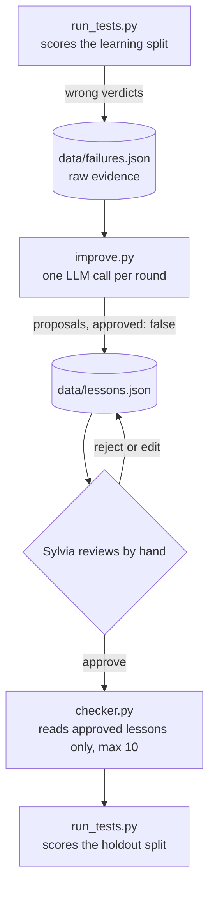

# Design: `improve.py`, the lesson generator

Owner: Sylvia (C). Status: draft for team review, written 2026-10-13.
Related files: `contracts/schema.py` (`Failure`, `Lesson`), `checker.py` (lesson selection),
`run_tests.py` and `run_rounds.py` (Amitej), README "Evaluation and improvement protocol".

## 1. What this script does

`improve.py` turns the learning-split mistakes in `data/failures.json` into short, general
lessons in `data/lessons.json`. A human then approves the good ones. `checker.py` reads only
approved lessons (at most ten per model) and adds them to its prompt. Nothing here changes
model weights; the loop changes the instructions the checker sees.



### Failure versus lesson

| | Failure | Lesson |
|---|---|---|
| Meaning | One specific wrong verdict, with the gold answer | One general rule drawn from one or more failures |
| Made by | `run_tests.py`, mechanically | `improve.py` proposes, a human approves |
| Contains gold label | Yes, always | No. It must not leak any test answer |
| Read by | `improve.py` only | `checker.py` |
| Why the checker never reads failures | A failure carries the hypothesis and its answer, so using it directly would let the checker memorize tests, cost far more tokens, and skip the human gate |

## 2. Decision: one mode, pattern-level with incremental edits

We implement a single generation mode. Each round, all learning-split failures for one model
go to the LLM in one call, together with that model's current lessons. For each failure the LLM
chooses one operation:

- **ADD**: propose a new lesson.
- **EDIT**: propose a revised version of an existing lesson that also covers the new failure.
- **NOOP**: an existing lesson already covers it; no new text.

Every proposal is stored as `approved: false` and takes effect only after manual approval.

Why this mode and not the alternatives:

| Alternative | Why not now |
|---|---|
| One lesson per failure (Reflexion style) | The checker takes at most ten lessons, so near-duplicates waste the budget. |
| Pair each failure with a correct case (ExpeL, ReasoningBank) | The learning split has about ten cases, so few pairs exist. |
| Vote counts that delete lessons (ExpeL) | Three rounds are too few for votes to mean anything; human review plus EDIT is enough. |
| Prompt evolution (GEPA, ProTeGi) | Needs many model calls and rewrites the whole prompt, not a bounded lessons section. |
| Hand-written lessons | Possible later as a reference point; not part of this build. |

Deferred, not rejected: a per-failure mode and a hand-written baseline, to compare against this
one. They would only differ in the prompt, but running them multiplies evaluation cost and
needs a way to select a lessons file per mode, which `checker.py` does not have. See section 11.

## 3. Constraints taken from the existing contracts

`improve.py` adds no field and no file format to `contracts/`.

- `Lesson` fields: `id`, `tag` (`falsifiability` | `prior_research` | `data_coverage` |
  `decision`), `text`, `source_test_ids` (at least one), `source_split` (always `learn`),
  `round`, `model`, `approved` (default false). Extra fields are rejected.
- `Failure` fields include `test_id`, `split`, `round`, `model`, `hypothesis`,
  `expected_decision`, `rationale`, `actual_verdict`.
- `checker.py` selects lessons that are approved, have `round <= current round`, and whose
  `model` equals the configured model ID. It sorts by round descending, then id ascending, and
  keeps the first ten (`MAX_APPROVED_LESSONS`). At round 0 it uses no lessons. Lesson IDs must
  be unique within the file.
- The README protocol: learning split first, failures to `improve.py`, manual review, then the
  holdout split with approved lessons. Holdout results must never reach `improve.py`.

Consequences:

1. A lesson's `round` is the round of the failures that produced it. The checker then makes it
   available for that round's holdout run and every later round.
2. IDs are `<model>-r<round>-<nn>` with `nn` zero-padded to two digits, so sorting by id is
   stable. The model part is a short slug of the configured model ID.
3. Because the checker silently drops everything past ten, `improve.py` warns whenever approved
   plus newly proposed lessons for a model would exceed ten, and the reviewer decides what to
   merge or retire. Silent truncation would hide which lessons were actually in force.
4. `Failure` has no field for the expected data or prior-research status, so the generator
   sees only the expected decision and the rationale.

## 4. Command line

```
python improve.py [FAILURES_PATH] --round N [--model deepseek|qwen] [--fake] [--dry-run] [--force]
python improve.py list    [--model M] [--round N] [--pending]
python improve.py approve ID [ID ...]
python improve.py unapprove ID [ID ...]
python improve.py reject  ID [ID ...]      # deletes a pending proposal
python improve.py status  --round N [--model M]   # exit 3 when proposals still await review
```

- `FAILURES_PATH` defaults to `data/failures.json`, falling back to
  `contracts/sample_failures.json` only if the real file does not exist (the repo's usual
  rule). A malformed file is an error, never a fallback.
- `--model` picks the provider through `config.get_config()`. The model being improved and the
  model doing the extraction are the same by default; this is what keeps DeepSeek and Qwen
  lesson histories separate (README requires separate histories).
- `--fake` uses a deterministic offline generator so Amitej can run `run_rounds.py` end to end
  without API keys. It writes lessons with `model: "fake"` and never touches a real model.
- `--dry-run` prints the proposals and writes nothing.
- `status` is the hook for `run_rounds.py`: it exits 3 while any proposal for that model and
  round is unreviewed, so the runner can pause instead of auto-approving.

`approve`, `unapprove` and `reject` exist so review does not require editing JSON by hand.
Editing the JSON directly stays valid; the next run validates the whole file.

## 5. Processing steps

1. **Load and validate.** Parse failures as `Failure`; parse existing lessons as `Lesson`.
2. **Learn-only guard.** Refuse any failure whose `split` is not `learn`. Refuse failures whose
   `model` differs from the configured model, or whose `round` differs from `--round`. If
   `data/tests.json` exists, also check every `test_id` is a learning-split test.
3. **Idempotency guard.** If pending or approved lessons already cite the same failures for
   this model and round, stop unless `--force` is given. This prevents a rerun from stacking
   duplicates.
4. **Build the prompt** (section 6) and make one LLM call with JSON output, temperature 0.
5. **Validate the response** (section 7). On failure, retry with the error message appended, up
   to `MAX_JSON_RETRIES`, the same way `checker.py` does.
6. **Write.** Convert accepted operations to `Lesson` records (`approved: false`), validate the
   whole list, and replace `data/lessons.json` atomically (write a temporary file, then rename).
7. **Log.** Append one record to `data/improve_log.jsonl` (section 8).
8. **Report.** Print the proposals, the count that await review, and any cap warning.

## 6. Prompt

The system message fixes the task and the rules. The user message carries the data. All
failure content is data, not instructions, as in `checker.py`.

System message (wording to be tuned during testing):

- You maintain a short list of lessons that help a checker judge research hypotheses. Return
  one JSON object and nothing else.
- Each lesson is one sentence of at most 30 words, usable on any hypothesis in the same
  situation. It must not mention the example's hypothesis, countries, papers, or variables
  that appear only in the example. General concepts are allowed, for example "event-only
  data lacks non-event cases".
- Pick the tag of the step that went wrong: `falsifiability`, `prior_research`,
  `data_coverage`, or `decision`.
- Do not state the correct decision for a specific example. State the principle.
- Prefer EDIT or NOOP over ADD when an existing lesson already covers the situation.
- Cover every failure exactly once.

User message sections:

1. The decision rubric (the README table, version 1.0), so the model knows what `proceed`,
   `revise` and `reject` mean.
2. Current lessons for this model, with ids and status (`approved` or `pending`), so it can
   EDIT or NOOP instead of duplicating.
3. The failures. For each: `test_id`, hypothesis, expected decision, the human rationale, and
   the checker's answer reduced to decision, decision reason, falsifiable status, prior
   research status, data coverage status and suggested rewording. The full verdict is not
   sent, to save tokens.

Required response shape:

```json
{"operations": [
  {"op": "ADD",  "failure_ids": ["t-03", "t-07"], "target_id": null,
   "tag": "data_coverage", "text": "..."},
  {"op": "EDIT", "failure_ids": ["t-05"], "target_id": "deepseek-r1-02",
   "tag": "decision", "text": "..."},
  {"op": "NOOP", "failure_ids": ["t-09"], "target_id": "deepseek-r1-01",
   "tag": null, "text": null}
]}
```

## 7. Validation of the model's response

Rejected and retried when any rule fails:

- Not valid JSON, or not this shape.
- The `failure_ids` across all operations are not exactly the input failures, each once.
- `tag` is not one of the four values (ADD and EDIT only).
- `target_id` is missing for EDIT or NOOP, or names a lesson that does not exist for this model.
- `text` is empty, spans several sentences or lines, or exceeds the word limit.
- **Leak check:** `text` shares any run of five consecutive words with a failure's hypothesis
  or rationale (after lowercasing and removing punctuation), or contains a test ID.

How operations become records:

| Operation | Result in `data/lessons.json` |
|---|---|
| ADD | New `Lesson`: new id, the given tag and text, `source_test_ids` = the covered failures, `round` = this round, `approved: false`. |
| EDIT | A new pending `Lesson` with a new id and `source_test_ids` = the old lesson's sources plus the new failures. The old lesson is left unchanged. The log records that the new one is meant to replace it; the reviewer approves the new one and runs `unapprove` on the old one. |
| NOOP | No new record. The log records that the cited lesson did not prevent this failure, which is a useful signal about that lesson. |

EDIT creates a new record rather than rewriting the old one because the contract has no
"superseded" field, and an in-place rewrite would silently change a lesson that was already
approved and already used in earlier runs.

## 8. Audit log

`data/improve_log.jsonl` gets one line per run:

- UTC timestamp, model ID, extractor model ID, round, prompt version, mode `"real"` or `"fake"`.
- The input failure IDs and a hash of the failures file.
- The raw model response and the accepted operations, including NOOPs and EDIT targets.
- IDs of lessons created.

This is an audit trail like `data/ledger.jsonl` and should be ignored by git by default (a
one-line `.gitignore` addition for Jia). Commit selected final logs if they belong in the
report.

## 9. Review procedure (Sylvia)

A proposal is approved only if all of these hold:

1. After removing every proper noun, it still states a rule that makes sense.
2. It does not give away the answer to a specific test (compare it with the failure's
   hypothesis and rationale).
3. It does not contradict an approved lesson.
4. It would change a verdict in a real, plausible case, not just restate the rubric.
5. The model has at most ten approved lessons after this change.

Optional check, not required for the first build: run the candidate on the learning split only
and see whether the failures it targets improve. Never run it on the holdout before approving.

Holdout results, errors and rationales are never shown to `improve.py` or used when choosing
which lessons to approve.

## 10. Testing and acceptance

Offline tests in `tests/test_improve.py`, using a fake client in the style of
`tests/test_checker.py`:

- ADD, EDIT and NOOP each produce the right records, ids and `source_test_ids`.
- Holdout failures, a wrong model, a wrong round and a missing operation for a failure are all refused.
- A response that repeats a hypothesis phrase fails the leak check and triggers a retry.
- A rerun without `--force` adds nothing.
- Lessons generated for one model are not visible to another in `list` and in `checker.load_inputs`.
- The written `lessons.json` loads through `checker.load_inputs` and respects the ten-lesson cap.
- `status` returns 3 while proposals await review and 0 afterwards.
- `--fake` on `contracts/sample_failures.json` works with no key and no network.

Done when:

1. `python improve.py contracts/sample_failures.json --round 0 --fake` works and
   `python -m unittest discover -s tests` passes.
2. One real run against sample failures produces sensible, general lessons for the configured model.
3. Amitej's runner can call `status` and pause for review.

## 11. Open questions for the team

- **Amitej:** `run_rounds.py` should call `improve.py` between the learning and holdout runs and
  pause while `status` exits 3. Is that acceptable, and does `failures.json` hold only the
  current round's failures (we assume it is overwritten each round)?
- **Jia:** may we add `data/improve_log.jsonl` to `.gitignore`? A per-mode lessons file would
  also need a `checker.py` change; we are not asking for that now.
- **Extractor model:** the default is the model being improved. A stronger extractor (as ExpeL
  used) might write better lessons, but then a lesson is no longer the model's own correction.
  Keep the default unless the first real run produces poor lessons.
- **Sample size:** with about ten learning and ten holdout cases, one changed answer moves
  holdout accuracy by ten points. Results will be reported as counts and treated as a small
  demonstration, as the README already states.

## 12. Prior work and what we take from it

Read level: abstracts and project pages for all items; for ExpeL, also the arXiv HTML page,
which is where its numbers come from. No paper was read in full. Items marked *preprint* have
not been through peer review as far as we could confirm.

| Work | What it contributes | What we take or leave |
|---|---|---|
| Shinn et al., **Reflexion: Language Agents with Verbal Reinforcement Learning**, NeurIPS 2023. [arXiv:2303.11366](https://arxiv.org/abs/2303.11366) | An agent writes a text reflection after a failure and keeps it in memory for later attempts, with no weight updates. Accepts scalar or free-text feedback. | Take: failures become text, not gradients. Leave: retrying the same task, which would leak test answers in our split design. |
| Zhao et al., **ExpeL: LLM Agents Are Experiential Learners**, AAAI 2024. [arXiv:2308.10144](https://arxiv.org/abs/2308.10144) | Extracts natural-language insights from failure/success pairs or batches of successes. The LLM edits an insight list with ADD, EDIT, UPVOTE, DOWNVOTE; counts start at two and an insight is dropped at zero. Reported HotpotQA success rates: ReAct 28.0, hand-written insights 32.0, full ExpeL 39.0 (full ExpeL also retrieves past successes). Adding reflections to the extraction lowered it to 29.0. | Take: the ADD/EDIT-style operations on a small list, and the finding that learned lists can beat none. Leave: voting, and pairing with successes, because three rounds and ten learning cases are too few. |
| Zhang et al., **Agentic Context Engineering (ACE)**, 2025. [arXiv:2510.04618](https://arxiv.org/abs/2510.04618) | Treats context as an evolving playbook of itemized entries updated by small increments, to avoid "brevity bias" and "context collapse" (repeated rewrites erasing detail). *Preprint when first posted; publication status not confirmed.* | Take: incremental edits instead of rewriting the whole list. Leave: its helpful/harmful counters and embedding-based pruning. |
| Suzgun et al., **Dynamic Cheatsheet: Test-Time Learning with Adaptive Memory**, EACL 2026. [arXiv:2504.07952](https://arxiv.org/abs/2504.07952) | A black-box model keeps a self-curated store of concise strategies, with no labels. | Background only. We have gold labels, so we do not rely on self-evaluation. |
| Ouyang et al., **ReasoningBank: Scaling Agent Self-Evolving with Reasoning Memory**, ICLR 2026. [arXiv:2509.25140](https://arxiv.org/abs/2509.25140) | Distills generalizable strategies from successes and failures; failures yield preventive lessons; contrasts failed and successful attempts. | Take: the idea that lessons should be general rather than a log. Leave: contrastive pairing, for lack of paired cases. |
| Agrawal et al., **GEPA: Reflective Prompt Evolution Can Outperform Reinforcement Learning**, ICLR 2026. [arXiv:2507.19457](https://arxiv.org/abs/2507.19457). Pryzant et al., **Automatic Prompt Optimization with "Gradient Descent" and Beam Search (ProTeGi)**, EMNLP 2023. [ACL Anthology](https://aclanthology.org/2023.emnlp-main.494) | Reflect on batches of errors in language and edit the prompt; GEPA keeps a Pareto set of candidates, ProTeGi uses beam search. | Take: batching errors into one reflection step. Leave: search over whole prompts, which needs many calls. |
| Xiong et al., **How Memory Management Impacts LLM Agents: An Empirical Study of Experience-Following Behavior**, ACL 2026. [ACL Anthology](https://aclanthology.org/2026.acl-long.27/) | Agents imitate similar stored experiences; errors in stored experiences propagate; some correct-looking experiences mislead; later task outcomes can serve as quality labels for stored memory. | Take: human approval gate before any lesson is used, and the optional learn-split check in section 9. |
| *Useful Memories Become Faulty When Continuously Updated by LLMs*, 2026, *preprint*. [arXiv:2605.12978](https://arxiv.org/abs/2605.12978) | Reports that repeated LLM consolidation of memory can make it worse than no memory, and that keeping raw episodes with gated consolidation works better. We have read only its abstract and summaries. | Take: keep raw failures separate from lessons, edit incrementally, and make changes gated. |
| *Hyperband-based Bayesian Optimization for Black-box Prompt Selection*, *preprint*. [arXiv:2412.07820](https://arxiv.org/abs/2412.07820) | Reports that very small validation sets make prompt selection noisy. We have read only a summary of this point. | Take: report holdout results as counts and treat differences of one case as noise. |

## 13. Decision log

| Date | Decision | Reason |
|---|---|---|
| 2026-10-13 | One generation mode: pattern-level ADD/EDIT/NOOP, human approval | Ten-lesson cap; avoids full rewrites; fits the existing contracts |
| 2026-10-13 | No change to `contracts/` | Keeps ownership rules and avoids a coordination cost the day before the demo |
| 2026-10-13 | EDIT creates a new pending lesson | The contract has no "superseded" field and approved lessons should not change silently |
| 2026-10-13 | Extractor model equals the model being improved | Keeps lesson histories separate per model, as the README requires |
| 2026-10-13 | Per-failure mode, hand-written baseline and multi-mode comparison deferred | Evaluation cost, small sample, and `checker.py` cannot select a lessons file per mode |
